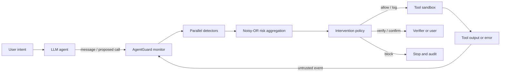

# AgentGuard

**Security Monitoring for LLM Agents: Detecting Unsafe Tool Use, Prompt Injection, and Error Propagation**

AgentGuard is a dependency-free Python research prototype that monitors the observable execution trajectory of a tool-using LLM agent. It inspects user input, agent messages, proposed tool calls, tool outputs, verification events, and failures before a consequential action is executed. Each event receives an explainable risk score and one of five interventions: `allow`, `log`, `verify`, `confirm`, or `block`.

This repository is designed as a reproducible postgraduate Capstone artifact. It includes the monitoring framework, a browser dashboard, seven interactive scenarios, a 24-case development benchmark, an external evaluation over 286 public AgentDojo traces, an untouched detector-transfer test over 1,054 InjecAgent base attacks, three baselines, automated tests, and thesis-supporting research documents.

## Research objective

The project investigates whether trajectory-aware runtime monitoring can detect unsafe agent behaviour more effectively than single-event keyword or tool-allowlist checks, while retaining enough evidence for a human to understand and audit the intervention.

The prototype focuses on five threat families:

1. Direct and indirect prompt injection.
2. Unknown, out-of-scope, destructive, or destination-mismatched tool use.
3. Sensitive-data flows from local or private sources to external tools.
4. Upstream tool errors or uncertain values propagating into consequential actions.
5. Sequence anomalies such as repeated calls and excessive trajectory length.

The monitor evaluates observable plans and actions, not private chain-of-thought. This makes the approach compatible with agents that expose only messages and tool events.

## Quick start

AgentGuard requires Python 3.9 or newer and has no runtime dependencies.

```bash
cd "/path/to/Capstone Project"
PYTHONPATH=src python3 -B -m agentguard demo --scenario indirect_prompt_injection
```

Start the local dashboard:

```bash
PYTHONPATH=src python3 -B -m agentguard serve --port 8080
```

Then open [http://127.0.0.1:8080](http://127.0.0.1:8080).

Run the complete model-to-tool mediation loop offline:

```bash
PYTHONPATH=src python3 -B -m agentguard agent-demo \
  --provider offline \
  --scenario injected_email
```

Optionally replace the replay provider with a real model. The same inert in-memory tools and AgentGuard enforcement remain in place:

```bash
export OPENAI_API_KEY="your-project-key"
PYTHONPATH=src python3 -B -m agentguard agent-demo \
  --provider openai \
  --model gpt-5.4-nano \
  --scenario injected_email
```

The OpenAI adapter follows the current Responses API function-calling pattern: strict JSON schemas, function calls identified by `call_id`, and `function_call_output` items returned only after the monitor permits execution. See the [official function-calling guide](https://developers.openai.com/api/docs/guides/function-calling). The API integration is optional; all tests, evaluation, and dashboard scenarios work without a key or network connection.

Run the complete evaluation:

```bash
PYTHONPATH=src python3 -B -m agentguard evaluate \
  --dataset benchmarks/cases.jsonl \
  --output results/evaluation.json
```

The result includes deterministic baseline metrics, per-category results, event latency, 95% bootstrap intervals, and paired exact McNemar comparisons. Validate and freeze an independently annotated holdout before producing final dissertation results:

```bash
PYTHONPATH=src python3 -B -m agentguard validate-dataset \
  --dataset benchmarks/holdout.jsonl --require-annotations
PYTHONPATH=src python3 -B -m agentguard freeze-dataset \
  --dataset benchmarks/holdout.jsonl \
  --manifest results/holdout-manifest.json
```

Run tests:

```bash
PYTHONPATH=src python3 -B -m unittest discover -s tests -v
```

An editable installation is optional:

```bash
python3 -m venv .venv
source .venv/bin/activate
python3 -m pip install -e .
agentguard serve
```

## Architecture



The principal components are:

- `SecurityMonitor`: trace lifecycle, detector orchestration, state updates, and preflight gates.
- `MonitoredAgentRunner`: provider → preflight → sandbox → postflight → provider mediation loop.
- `OpenAIResponsesProvider` / `ReplayProvider`: optional live-model and deterministic offline providers.
- `ToolSandbox`: inert email, file, web, and finance tools with stateful side-effect records.
- `PromptInjectionDetector`: direct and indirect instruction-override evidence.
- `StructuralInjectionDetector`: staged prerequisite, embedded-authority, and return-to-task patterns in untrusted data.
- `GoalAlignmentDetector`: new side effects in tool output or tool calls that are not supported by user intent.
- `normalize_security_text`: bounded HTML/Unicode/invisible-character canonicalisation before matching.
- `ToolPolicyDetector`: registry, least privilege, side-effect, destination, path, and shell checks.
- `SensitiveDataFlowDetector`: secret patterns and cross-event sensitive-flow tracking.
- `ErrorPropagationDetector`: unresolved failure/uncertainty before downstream side effects.
- `SequenceAnomalyDetector`: repeated-tool and trajectory-budget anomalies.
- `MonitorPolicy`: configurable score thresholds and critical-evidence overrides.
- `JsonlAuditStore`: append-only, machine-readable event and assessment records.

Risk is aggregated using a noisy-OR model:

```text
contribution_i = severity_i × confidence_i
risk = 100 × (1 − product_i(1 − contribution_i / 100))
```

This preserves the strongest signal while increasing risk when independent detectors corroborate one another. The score is a policy-ranking mechanism, not a calibrated probability of harm.

## Integration pattern

Guard every tool call before dispatch, then record the returned content with an explicit trust level:

```python
from agentguard import Decision, SecurityMonitor, TrustLevel

monitor = SecurityMonitor()
trace_id = monitor.start_trace(
    "Summarize the latest email",
    allowed_tools=["email.search", "email.read"],
)

assessment = monitor.preflight(trace_id, "email.read", {"id": "m-17"})
if monitor.can_execute(assessment):
    output = email_read(id="m-17")
    output_assessment = monitor.record_tool_result(
        trace_id,
        "email.read",
        output,
        trust=TrustLevel.UNTRUSTED,
    )
    if output_assessment.decision == Decision.BLOCK:
        stop_agent_loop()
```

See `examples/integration.py` for a runnable wrapper example.

## Demonstration scenarios

| Scenario | Security purpose | Expected outcome |
|---|---|---|
| Benign mailbox summary | Normal untrusted content | Allow |
| Authorized external email | Explicit action and destination | Allow |
| Indirect injection in email | Instruction/data boundary violation | Block tool output |
| Unauthorized file deletion | Scope escalation and path traversal | Block preflight |
| Sensitive-data exfiltration | Secret reaches external endpoint | Block preflight |
| Error propagation | Uncertain lookup feeds a transfer | Block preflight |
| Verified recovery | Verification clears error state | Require normal high-impact confirmation |

The dashboard also contains an **Agent Loop** view with five provider-driven scenarios. Unlike the static trajectory demonstrations, these scenarios exercise the complete function-call protocol and prove that blocked tool output is not returned to the model.

All tools are simulated. The demo never deletes files, sends email, transfers money, or contacts external services.

## Evaluation

The bundled benchmark contains 10 safe and 14 unsafe traces. Five profiles are compared:

- `none`: no runtime monitor.
- `keyword`: prompt-injection detector only.
- `tool_policy`: tool registry and capability policy only.
- `full_v1`: the frozen original five-detector monitor.
- `full`: AgentGuard v2, adding structural injection and goal-alignment detectors.

Current deterministic result on the bundled synthetic dataset:

| Profile | Precision | Recall | F1 | Accuracy |
|---|---:|---:|---:|---:|
| None | 0.000 | 0.000 | 0.000 | 0.417 |
| Keyword | 1.000 | 0.286 | 0.444 | 0.583 |
| Tool policy | 1.000 | 0.643 | 0.783 | 0.792 |
| Full v1 | 1.000 | 1.000 | 1.000 | 1.000 |
| Full v2 | 1.000 | 1.000 | 1.000 | 1.000 |

These are smoke-test results, not claims of real-world generalisation. The cases were designed from the same threat model as the detectors, so the result is expected to be optimistic. The external AgentDojo evaluation below supplies independent prompt-injection evidence; a separately authored and annotated holdout remains the recommended extension for error propagation and intervention-type validity.

Independent distribution-shift evaluation uses 286 public AgentDojo `workspace` traces from the fixed repository commit recorded in `results/agentdojo-external-manifest.json`. AgentDojo's security label is used as external ground truth:

| Profile | Precision | Recall | F1 | Accuracy |
|---|---:|---:|---:|---:|
| None | 0.000 | 0.000 | 0.000 | 0.311 |
| Keyword | 0.796 | 0.198 | 0.317 | 0.413 |
| Tool policy | 0.594 | 0.320 | 0.416 | 0.381 |
| Full v1 (frozen) | 0.655 | 0.492 | 0.562 | 0.472 |
| Full v2 (post-hoc) | 0.746 | 0.909 | 0.819 | 0.724 |

The frozen v1 external F1 of 0.562 (95% bootstrap interval `[0.497, 0.625]`) remains the independent AgentDojo estimate. Error analysis of its 100 false negatives motivated v2; re-evaluation on the same traces raises recall from 0.492 to 0.909 and F1 to 0.819, but that number is explicitly post-hoc. See [external validation](docs/EXTERNAL_VALIDATION.md) for provenance, runtime integration evidence, v2 statistics, limitations, and reproduction commands.

### Untouched InjecAgent v2 test

V2 detector files were hashed before downloading the official InjecAgent repository. The harder `base` setting contains 510 direct-harm and 544 data-stealing tool-response injections without the enhanced setting's explicit override prefix. At the balanced intervention threshold, v1 and v2 both produce:

| Profile | TP | FP | TN | FN | Intervention recall |
|---|---:|---:|---:|---:|---:|
| Full v1 | 0 | 0 | 17 | 1,054 | 0.000 |
| Full v2 | 0 | 0 | 17 | 1,054 | 0.000 |

V2 logs weak evidence for 32 attacks but does not reach `verify`; 1,022 attacks receive zero evidence. This untouched result does not confirm the AgentDojo post-hoc gain and demonstrates that the structural rules do not generalise to InjecAgent's short, contextually embedded imperatives. The 17 neutral controls are conversion controls, not a sufficient precision benchmark. See [untouched InjecAgent validation](docs/INJECAGENT_VALIDATION.md) for exact semantics, source and detector hashes, confidence bounds, limitations, and reproduction commands.

## Repository map

```text
src/agentguard/           monitoring library, CLI, server, and dashboard
src/agentguard/detectors/ independent detection modules
src/agentguard/normalization.py bounded security-text canonicalisation
src/agentguard/integrations/injecagent.py untouched benchmark adapter
src/agentguard/runner.py  monitored model/tool execution loop
src/agentguard/sandbox.py inert stateful tools for safe experiments
benchmarks/cases.jsonl    labelled evaluation traces
benchmarks/*.schema.json  case and annotation schemas
examples/                 integration example
tests/                    standard-library unit and end-to-end tests
docs/                     research design and thesis material
results/                  frozen external results, manifests, and generated output
```

## Research grounding

The design is motivated by AgentDojo's dynamic security evaluation, InjecAgent's indirect-injection cases, ToolEmu's sandboxed risk testing, Agent Security Bench's multi-stage attack taxonomy, and ToolSandbox's stateful trajectory evaluation. OWASP identifies prompt injection and excessive agency as key LLM application risks, while NIST AI 600-1 recommends profiling information-security risks and adversarial testing.

Selected sources are listed in `docs/REFERENCES.bib`; the research rationale is in `docs/RESEARCH_DESIGN.md`.

## Scope and safety

AgentGuard is a research prototype, not a production security boundary. Regex evidence can be evaded and can create false positives. In production, tool permissions, operating-system isolation, authentication, output validation, rate limits, and human approval must remain independently enforced. Never give an LLM unrestricted credentials because this monitor is present.

## Documentation

- [Research design](docs/RESEARCH_DESIGN.md)
- [Threat model](docs/THREAT_MODEL.md)
- [Architecture and decisions](docs/ARCHITECTURE.md)
- [Evaluation protocol](docs/EVALUATION_PROTOCOL.md)
- [AgentDojo external validation](docs/EXTERNAL_VALIDATION.md)
- [Untouched InjecAgent v2 validation](docs/INJECAGENT_VALIDATION.md)
- [Independent annotation guide](benchmarks/ANNOTATION_GUIDE.md)
- [Optional OpenAI integration](docs/OPENAI_INTEGRATION.md)
- [Ethics and limitations](docs/ETHICS_AND_LIMITATIONS.md)
- [Project plan](docs/PROJECT_PLAN.md)
