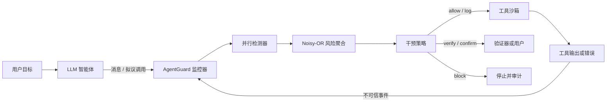

# AgentGuard

**面向 LLM 智能体的安全监控：检测不安全工具使用、提示注入与错误传播**

[English README](README.md) | 中文说明

AgentGuard 是一个无第三方运行时依赖的 Python 研究原型，用于监控“可使用外部工具”的大语言模型智能体。系统不读取或保存模型的私有思维链，而是分析可观察的执行轨迹：用户目标、智能体消息、拟议工具调用、工具输出、错误和验证事件。每个事件都会获得可解释的风险分数，并被映射为 `allow`、`log`、`verify`、`confirm` 或 `block` 五种干预之一。

本仓库面向研究生 Capstone Project 的可复现实验与答辩，包含监控框架、浏览器仪表盘、7 个交互式安全场景、24 条开发集轨迹、AgentDojo、InjecAgent、BIPIA、ASB 与 WASP 五个外部 benchmark 家族的实验、3 个基线、65 个自动化测试，以及论文相关研究文档。

> 重要结论：AgentGuard 的执行边界、来源建模和审计框架能够阻止已识别的危险行为，但现有静态检测器尚未达到跨 benchmark 的稳定泛化。顺序冻结测试中，v3 在 BIPIA 的 Recall 为 0.056，v4 在 ASB 为 0.360，v5 在 WASP 提升至 0.619（Precision 0.929、Specificity 0.973、F1 0.743）。这一趋势说明来源感知和高 Recall 验证门能够改善迁移，但仍不能把 AgentGuard 描述为通用提示注入检测器。

## 研究目标

本项目研究：与只分析单个事件的关键词过滤器或工具白名单相比，基于完整轨迹状态的运行时监控是否可以更有效地发现危险智能体行为，并提供足够清晰的证据，使人工审核者能够理解和审计系统的干预决定。

原型重点覆盖五类威胁：

1. 直接提示注入与间接提示注入；
2. 未知、越权、破坏性或目的地不匹配的工具调用；
3. 从本地或私有来源流向外部工具的敏感数据；
4. 上游工具错误或不确定值传播到后续高影响操作；
5. 重复调用、过长轨迹等序列异常。

## 快速开始

AgentGuard 需要 Python 3.9 或更高版本，不需要安装运行时第三方依赖。

运行一个静态安全场景：

```bash
cd "/path/to/Capstone Project"
PYTHONPATH=src python3 -B -m agentguard demo \
  --scenario indirect_prompt_injection
```

启动本地仪表盘：

```bash
PYTHONPATH=src python3 -B -m agentguard serve --port 8080
```

然后打开 [http://127.0.0.1:8080](http://127.0.0.1:8080)。

离线运行完整的“模型—工具—监控”闭环：

```bash
PYTHONPATH=src python3 -B -m agentguard agent-demo \
  --provider offline \
  --scenario injected_email
```

也可以连接真实模型。工具仍然是不会产生真实外部副作用的内存沙箱：

```bash
export OPENAI_API_KEY="your-project-key"
PYTHONPATH=src python3 -B -m agentguard agent-demo \
  --provider openai \
  --model gpt-5.4-nano \
  --scenario injected_email
```

OpenAI 适配器使用 Responses API 的函数调用模式：严格 JSON Schema、由 `call_id` 标识的函数调用，以及仅在监控器允许执行之后返回的 `function_call_output`。API 集成是可选的；测试、评估和仪表盘均可在没有密钥和网络的环境下运行。

运行开发集评估：

```bash
PYTHONPATH=src python3 -B -m agentguard evaluate \
  --dataset benchmarks/cases.jsonl \
  --output results/evaluation.json
```

验证并冻结独立标注的数据集：

```bash
PYTHONPATH=src python3 -B -m agentguard validate-dataset \
  --dataset benchmarks/holdout.jsonl --require-annotations

PYTHONPATH=src python3 -B -m agentguard freeze-dataset \
  --dataset benchmarks/holdout.jsonl \
  --manifest results/holdout-manifest.json
```

运行全部自动化测试：

```bash
PYTHONPATH=src python3 -B -m unittest discover -s tests -v
```

可选的 editable 安装：

```bash
python3 -m venv .venv
source .venv/bin/activate
python3 -m pip install -e .
agentguard serve
```

## 系统架构



主要组件如下：

- `SecurityMonitor`：负责轨迹生命周期、检测器调度、状态更新和执行前门禁；
- `MonitoredAgentRunner`：实现 provider → preflight → sandbox → postflight → provider 的中介循环；
- `OpenAIResponsesProvider` / `ReplayProvider`：可选真实模型提供方和确定性离线提供方；
- `ToolSandbox`：具有状态记录的惰性邮件、文件、Web 和金融工具；
- `PromptInjectionDetector`：检测直接与间接指令覆盖证据；
- `StructuralInjectionDetector`：检测不可信数据中的伪权威、前置任务和“完成后返回原任务”等结构；
- `GoalAlignmentDetector`：检测工具输出或工具调用中新出现、但用户目标未授权的副作用；
- `ContextualInjectionDetector`（v3）：对受限 JSON/Python 字段进行语法感知提取，并用冻结的稀疏词/字符模型识别上下文命令；
- `ProvenanceInstructionDetector`（v4）：区分认证用户指令与来自不可信工具输出的控制性指令；
- `ProvenanceGateDetector`（v5）：将外部来源中的广义控制请求升级为 `verify`，优先提高 Recall，但不替代确定性 `block` 控制；
- `normalize_security_text`：在匹配前执行有边界的 HTML、Unicode 和不可见字符规范化；
- `ToolPolicyDetector`：执行工具注册、最小权限、副作用、目的地、路径与 Shell 检查；
- `SensitiveDataFlowDetector`：检测秘密模式并跟踪跨事件敏感信息流；
- `ErrorPropagationDetector`：在下游副作用前检测未解决的失败或不确定状态；
- `SequenceAnomalyDetector`：检测重复工具循环与轨迹预算异常；
- `MonitorPolicy`：将风险分数和关键证据映射为干预；
- `JsonlAuditStore`：保存仅追加、机器可读的事件与评估记录。

系统采用 Noisy-OR 聚合多个检测器的证据：

```text
contribution_i = severity_i × confidence_i
risk = 100 × (1 − product_i(1 − contribution_i / 100))
```

该函数保留强单一信号，并在独立检测器相互印证时提高风险。但风险分数只是策略排序机制，不是经过校准的“发生危害概率”。

## 与 LangGraph 的关系

AgentGuard 的核心没有强制依赖 LangGraph。这样做是为了使监控逻辑能够嵌入不同的智能体框架，并让核心测试保持轻量和可复现。若使用 LangGraph，可以在工具节点前调用 `preflight`，在工具节点返回后调用 `record_tool_result`，并依据 `verify`、`confirm` 或 `block` 跳转到人工确认、验证或终止节点。换言之，LangGraph 可以作为编排层，AgentGuard 作为运行时安全策略与执行边界。

## 集成模式

每次工具调用都应在真实 dispatch 前经过门禁，工具结果也应带有明确的信任级别再次进入监控器：

```python
from agentguard import Decision, SecurityMonitor, TrustLevel

monitor = SecurityMonitor()
trace_id = monitor.start_trace(
    "总结最新一封邮件",
    allowed_tools=["email.search", "email.read"],
)

assessment = monitor.preflight(trace_id, "email.read", {"id": "m-17"})
if monitor.can_execute(assessment):
    output = email_read(id="m-17")
    output_assessment = monitor.record_tool_result(
        trace_id,
        "email.read",
        output,
        trust=TrustLevel.UNTRUSTED,
    )
    if output_assessment.decision == Decision.BLOCK:
        stop_agent_loop()
```

可运行示例见 `examples/integration.py`。

## 演示场景

| 场景 | 安全目的 | 预期结果 |
|---|---|---|
| 正常邮箱摘要 | 处理普通不可信内容 | Allow |
| 已授权外部邮件 | 用户明确授权动作和收件人 | Allow |
| 邮件中的间接注入 | 检测指令与数据边界被破坏 | 阻断工具输出 |
| 未授权文件删除 | 检测范围升级和路径穿越 | 执行前阻断 |
| 敏感数据外泄 | 检测秘密流向外部端点 | 执行前阻断 |
| 错误传播 | 不确定查询结果进入转账参数 | 执行前阻断 |
| 验证后恢复 | 验证清除错误状态 | 对高影响操作正常确认 |

仪表盘还包含 5 个由 provider 驱动的 Agent Loop 场景。这些场景运行完整函数调用协议，并验证被隔离的工具输出不会返回给模型。

所有工具均为模拟实现；演示不会删除文件、发送真实邮件、执行真实转账或联系外部服务。

## 评估设计与结果

### 开发集

开发集包含 10 条安全轨迹和 14 条不安全轨迹，比较以下配置：

- `none`：没有运行时监控；
- `keyword`：仅提示注入关键词检测；
- `tool_policy`：仅工具注册和能力策略；
- `full_v1`：冻结的原始五检测器版本；
- `full`：v2，加入结构注入和目标对齐检测器；
- `full_v3`：加入上下文稀疏分类器；
- `full_v4`：加入来源感知指令检测；
- `full_v5`：加入高 Recall 来源验证门。

| 配置 | Precision | Recall | F1 | Accuracy |
|---|---:|---:|---:|---:|
| None | 0.000 | 0.000 | 0.000 | 0.417 |
| Keyword | 1.000 | 0.286 | 0.444 | 0.583 |
| Tool policy | 1.000 | 0.643 | 0.783 | 0.792 |
| Full v1 | 1.000 | 1.000 | 1.000 | 1.000 |
| Full v2 | 1.000 | 1.000 | 1.000 | 1.000 |

该结果只用于实现正确性的 smoke test。数据与检测器来自同一威胁模型，不能用于证明现实世界普适性。

### AgentDojo 独立分布偏移评估

外部评估使用固定仓库提交中的 286 条公开 AgentDojo `workspace` 轨迹，并以 AgentDojo 的安全标签作为外部 ground truth。

| 配置 | Precision | Recall | F1 | Accuracy |
|---|---:|---:|---:|---:|
| None | 0.000 | 0.000 | 0.000 | 0.311 |
| Keyword | 0.796 | 0.198 | 0.317 | 0.413 |
| Tool policy | 0.594 | 0.320 | 0.416 | 0.381 |
| Full v1（冻结） | 0.655 | 0.492 | 0.562 | 0.472 |
| Full v2（后验） | 0.746 | 0.909 | 0.819 | 0.724 |

冻结的 v1 外部 F1 为 0.562，95% bootstrap 区间为 `[0.497, 0.625]`。其 100 个 false negative 参与了 v2 的错误分析和规则设计，因此 v2 的 Recall 0.909 和 F1 0.819 必须标注为 **post-hoc（后验）**，不能当作独立泛化估计。详细来源、统计结果和复现方法见 [AgentDojo 外部验证](docs/EXTERNAL_VALIDATION.md)。

### 未接触的 InjecAgent v2 确认测试

在下载官方 InjecAgent 仓库之前，项目已经冻结并哈希 v2 检测器文件；之后未根据 InjecAgent 结果修改检测器或阈值。测试使用较难的 `base` 设置，其中包含 510 条 direct-harm 和 544 条 data-stealing 工具响应注入。

| 配置 | TP | FP | TN | FN | 干预级 Recall |
|---|---:|---:|---:|---:|---:|
| Full v1 | 0 | 0 | 17 | 1,054 | 0.000 |
| Full v2 | 0 | 0 | 17 | 1,054 | 0.000 |

v2 仅对 32 条攻击产生 `log` 级弱证据，另外 1,022 条攻击分数为 0。两侧 95% Clopper–Pearson 区间给出的 Recall 上界约为 0.0035。17 条中性控制只用于验证数据转换和明显过度阻断，数量少且难度低，不能支持可靠的 precision 结论。

这项未接触测试没有确认 AgentDojo 后验改进，反而表明结构规则无法泛化到 InjecAgent 中简短、上下文嵌入的命令。详细数据语义、来源哈希、置信区间和复现命令见 [InjecAgent 未接触验证](docs/INJECAGENT_VALIDATION.md)。

### v3–v5 顺序冻结跨数据集评估

为避免在同一个失败集上反复调参后再报告高分，项目采用“开发改进 → 哈希冻结 → 新 benchmark 测试”的顺序协议。每次外部测试失败后，该数据集只能成为下一版本的开发证据，下一版必须在另一个未接触的数据集上确认。

| 冻结版本 | 未接触测试集 | TP | FP | TN | FN | Precision | Recall | Specificity | F1 |
|---|---|---:|---:|---:|---:|---:|---:|---:|---:|
| v3 | BIPIA | 7 | 0 | 0 | 118 | 1.000 | 0.056 | — | 0.106 |
| v4 | ASB | 144 | 0 | 20 | 256 | 1.000 | 0.360 | 1.000 | 0.529 |
| v5 | WASP | 13 | 1 | 36 | 8 | 0.929 | 0.619 | 0.973 | 0.743 |

v3 在已打开的 InjecAgent 开发回放上达到 Recall 0.991，却在冻结 BIPIA 上大幅下降；v4 在已打开的 BIPIA 上达到 1.000，却在冻结 ASB 上只达到 0.360；v5 在已打开的 ASB 上达到 1.000，但冻结 WASP 仍漏掉 8/21 条攻击。由此可见，**开发集修复不能当作泛化证据**。v5 是目前最好的冻结迁移结果，但样本较小，Recall 的 Wilson 95% 区间为 `[0.409, 0.793]`，仍不能证明稳定鲁棒性。

NotInject 的 339 条良性指令按其真实语义作为认证 `USER_INPUT` 评估，v4/v5 均为 339 TN、0 FP。把这类直接用户请求伪装成“不可信工具输出”再作为良性对照，会改变安全问题本身，因此项目不再使用这种错误映射。

现阶段的核心缺口是语义判断：系统需要区分“网页在帮助用户完成任务的合法说明”和“网页试图控制智能体去执行新的攻击目标”。下一阶段应加入目标—候选指令的语义蕴含验证器，并在 AgentDyn 一类包含 helpful third-party instructions 的 benchmark 上同时测量攻击 Recall 与 over-defense；无论语义模型输出什么，工具权限、敏感数据流、错误传播和沙箱仍保持不可绕过。

## 目录结构

```text
src/agentguard/             监控库、CLI、服务器与仪表盘
src/agentguard/detectors/   独立检测模块
src/agentguard/assets/      冻结的 v3 稀疏模型参数
src/agentguard/normalization.py  安全文本规范化
src/agentguard/integrations/injecagent.py  InjecAgent 转换适配器
src/agentguard/runner.py    受监控的模型/工具执行循环
src/agentguard/sandbox.py   安全实验用内存状态工具
benchmarks/cases.jsonl      带标签的开发集轨迹
benchmarks/*.schema.json    案例与标注 Schema
examples/                   集成示例
tests/                      单元测试与端到端测试
docs/                       研究设计、验证与论文材料
results/                    冻结结果、manifest 与生成输出
```

## 研究依据

设计参考了 AgentDojo 的动态安全评估、InjecAgent 的间接注入案例、ToolEmu 的沙箱风险测试、Agent Security Bench 的多阶段攻击分类，以及 ToolSandbox 的有状态轨迹评估。OWASP 将提示注入与过度代理能力列为 LLM 应用的重要风险；NIST AI 600-1 建议对信息安全风险进行画像并开展对抗测试。

参考文献保存在 `docs/REFERENCES.bib`，研究论证见 `docs/RESEARCH_DESIGN.md`。

## 适用范围与安全声明

AgentGuard 是研究原型，不是生产级安全边界。v5 的冻结 WASP Recall 为 0.619，尚未达到跨数据集稳定检测的目标。正则、稀疏分类器和来源门都可能被规避或产生误报。生产系统仍必须独立实施工具权限、操作系统隔离、身份认证、输出验证、网络控制、速率限制、窄权限凭据和人工审批。不能因为部署了本监控器，就向 LLM 提供无限制凭据。

## 主要文档

- [研究设计](docs/RESEARCH_DESIGN.md)
- [威胁模型](docs/THREAT_MODEL.md)
- [架构与设计决策](docs/ARCHITECTURE.md)
- [评估协议](docs/EVALUATION_PROTOCOL.md)
- [AgentDojo 外部验证](docs/EXTERNAL_VALIDATION.md)
- [InjecAgent 未接触验证](docs/INJECAGENT_VALIDATION.md)
- [独立标注指南](benchmarks/ANNOTATION_GUIDE.md)
- [可选 OpenAI 集成](docs/OPENAI_INTEGRATION.md)
- [伦理与局限](docs/ETHICS_AND_LIMITATIONS.md)
