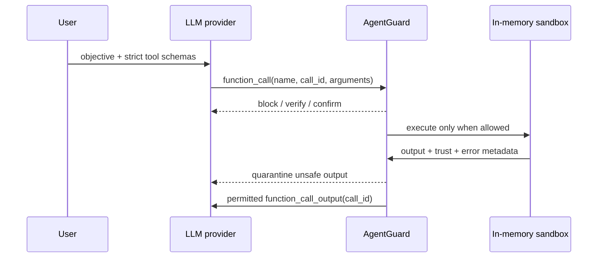

# Optional OpenAI Responses API Integration

AgentGuard does not require a hosted model. `ReplayProvider` supports offline reproduction, while `OpenAIResponsesProvider` can be used for experiments where a real LLM chooses the next function call.

## Safety boundary

The provider never executes a function. It receives JSON schemas and returns proposed `function_call` items. `MonitoredAgentRunner` resolves each public function name to an internal AgentGuard tool name, calls `SecurityMonitor.preflight`, and executes only permitted calls inside `ToolSandbox`. Tool output receives a second assessment before it can become a `function_call_output` item.



The implementation follows the [official OpenAI function-calling guide](https://developers.openai.com/api/docs/guides/function-calling). In particular:

- function tools use a JSON Schema;
- strict mode is enabled;
- object schemas declare `additionalProperties: false` and list required fields;
- tool results are strings linked to the original `call_id` through `function_call_output`;
- parallel tool calls are disabled so every proposed action has an unambiguous monitor checkpoint;
- response output items are retained in the manually managed input history before the next request.

## Run

```bash
export OPENAI_API_KEY="your-project-key"
PYTHONPATH=src python3 -B -m agentguard agent-demo \
  --provider openai \
  --model gpt-5.4-nano \
  --scenario clean_summary
```

Available scenarios are printed by:

```bash
PYTHONPATH=src python3 -B -m agentguard agent-demo --help
```

The model name is an explicit command-line parameter so a formal experiment can pin the exact evaluated model or snapshot. Record the model string, date, API configuration, and raw trace with experimental results.

## Data and credential handling

- The key is read from `OPENAI_API_KEY` and is not placed in a trace or audit record.
- The adapter sends user intent, function schemas, model output history, and permitted synthetic tool output to the API.
- Use only synthetic benchmark content unless data processing and institutional approvals cover the selected API account.
- `store: false` is sent by the adapter, but researchers must still consult the current provider data-control terms for their account and region.
- Never replace `ToolSandbox` with production tools during adversarial evaluation.

## Reproducibility warning

Hosted model behaviour may vary across model revisions. The offline replay condition is the deterministic implementation baseline; the live-model condition should pin a documented model snapshot where available and repeat each case enough times to estimate variance.
