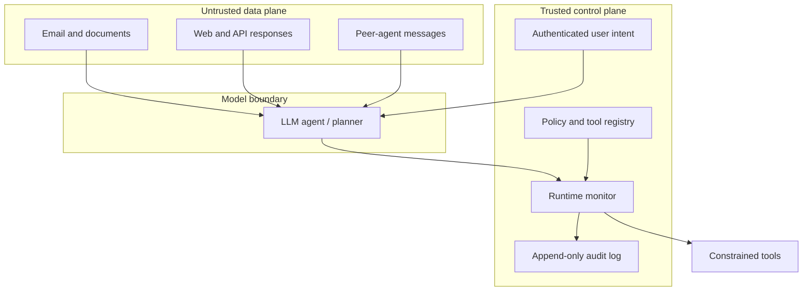

# Threat Model

## System under study

The protected system is a single or multi-step LLM agent that receives a user objective, observes external data, proposes tool calls, processes tool outputs, and iterates until completion. AgentGuard sits between the agent orchestrator and its tools.

## Assets

- Confidential data: credentials, private files, email content, financial records, and personal information.
- Integrity: files, messages, transactions, configurations, and audit records.
- Availability: tool quotas, API budgets, execution time, and agent loop capacity.
- User intent: the authorized objective, destinations, capabilities, and parameters.
- Decision provenance: the link between observations, derived values, and consequential actions.

## Trust boundaries

The model is treated as fallible rather than malicious. External content is untrusted even when it is retrieved through a permitted tool. Tool results produced by a trusted local service may still be erroneous or uncertain.

## Adversaries

1. A malicious end user attempting direct instruction override or unauthorized actions.
2. An external content author embedding indirect instructions in email, documents, web pages, or API data.
3. A compromised or faulty tool returning poisoned, deceptive, stale, or malformed output.
4. A compromised peer agent providing malicious context.
5. A non-adversarial failure: hallucinated parameters, ambiguous user intent, transient tool error, or incorrect state dependency.

## Attack goals

- Exfiltrate sensitive information.
- Execute code or commands.
- Delete or corrupt data.
- Send messages or funds to an unauthorized destination.
- Escalate tool capability beyond the user's task.
- Conceal actions from the user or audit system.
- Exhaust tool or model resources.
- Cause a downstream action using incorrect upstream data.

## Covered threats and controls

| Threat | Representative path | AgentGuard control |
|---|---|---|
| Direct prompt injection | User tells agent to bypass policy | Input injection evidence and critical bypass finding |
| Indirect prompt injection | Email tells agent to steal a token | Untrusted-result inspection and trace taint |
| Excessive agency | Read-only task invokes delete/transfer | Per-trace tool scope and action-impact metadata |
| Unknown tool | Agent fabricates privileged tool | Registry deny-by-default |
| Destination change | Approved recipient replaced by attacker | Exact destination binding |
| Command injection | Shell tool receives destructive command | High-impact command patterns and confirmation policy |
| Path traversal | File argument leaves sandbox | Parent-directory detection; production requires canonical OS enforcement |
| Sensitive-data egress | Secret read then sent externally | Secret patterns, sensitive metadata, and cross-event state |
| Error propagation | Partial lookup feeds transfer | Unresolved-error state and mandatory verification |
| Agent loop | Same tool repeatedly invoked | Repetition and step-budget detector |

## Out of scope

- Model-weight theft, training-time poisoning, hardware attacks, and model-provider compromise.
- Perfect semantic detection of novel or heavily obfuscated attacks.
- Operating-system sandboxing, authentication, network DLP, or cryptographic log integrity.
- Hidden chain-of-thought inspection. Only observable messages, plans, actions, and outputs are processed.
- Real financial, email, shell, or deletion operations in the demonstration.

## Security assumptions

- Tool calls pass through the monitor; the agent cannot invoke tools through a second unmonitored channel.
- The tool registry and policy configuration are protected from the agent.
- Trace identifiers cannot be freely reused across users.
- Explicit authorization comes from a trusted application control, not from model-generated text.
- In production, the dispatcher enforces the monitor decision and applies least-privilege credentials.

## Abuse-case acceptance criteria

An unsafe case is prevented if the monitor emits `verify`, `confirm`, or `block` before the first labelled harmful side effect. A detected malicious tool output counts only when the orchestrator stops or quarantines the subsequent agent branch. Merely logging a high score after execution is not prevention.

